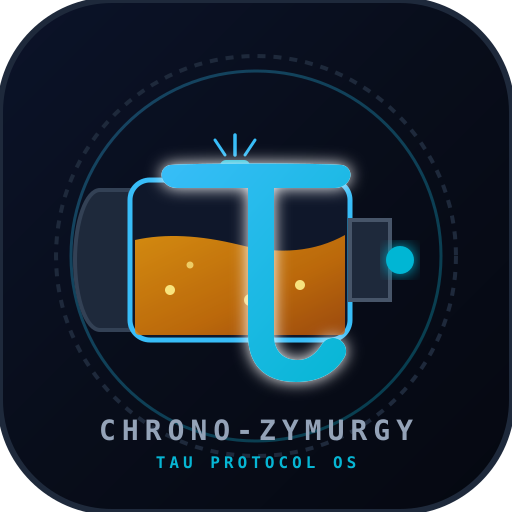

# CHRONO-ZYMURGY OS: The Open-Source Pinter &amp; &tau;-Protocol Engine
### Standalone Native Desktop Application for Pop!_OS Linux



> **"Break free from proprietary $38 Fresh Presses and 19th-century British brewing dogma."**

**CHRONO-ZYMURGY OS** is a standalone, native Linux desktop application engineered for Pop!_OS Linux using **Electron + Vite + React + Tailwind CSS + Recharts + Lucide-React**.

---

## Key Features

### 1. Dual-Mode Terminology Toggle (Header Switch)
Instantly switches every metric badge, chart axis, tooltip, and report between:
- **🔬 Biophysics Lab Mode (SKL / $\tau$):** *Chrono-Metabolic Zymurgy / Soma-Kinetic Lexicon* (Henry's law transfer, Stokes' hydrodynamic settling, $G_n$ replicative generations, diacetyl cushion $D_c$, terpene lift $T_L$).
- **🧠 Human-Experience Mode:** *Living-Rhythm Brewing / Visceral Feel* (Breath clock, warm rest & sweetening window, sip weight & silk, butterscotch glow, bubble tingle, golden fuzzy buzz).

### 2. 24-Kit Master Catalog & DIY Open-Source Fresh Press Builder
- **Flagship Reference Formulation:** Features the fully unlocked, 100% original reference recipe **Hazy Tau IPA** (Double Dry-Hopped Hazy IPA), showcasing the complete Bill of Materials, hop tea extraction kinetics, and biophysical vector radar profiles.

- **Chrono-Vault Security Gating:** Commercial clone Bill of Materials formulations are encrypted under a local protocol key, demonstrating clean architectural gating while showcasing the entire catalog's kinetic curves, style classifications, and economic telemetry.
- **DME / LME Unit Converter:** Real-time toggling between Dry Malt Extract (g / oz) and Liquid Malt Extract ($\times 1.22$ factor).
- **10-Minute Hop Teas:** Concentrated hop boil schedules scaled for the 5,450 mL fill line.
- **DIY Hopper Tinctures:** 48-hour 60mL vodka hop tinctures or commercial hop oil additions.
- **Cost Savings Breakdown:** Commercial retail price ($32–$46) vs DIY batch cost ($9.50–$13.00), demonstrating **70–75% cost reduction per batch**.
- **+ Create Custom DIY Kit Modal:** Save custom recipes directly to local storage.

### 3. Unified Multi-Physics & Yeast Dynasty Simulator
- **7 Master Controls:**
  1. Active Kit Baseline Selector
  2. Ambient Room Temperature ($T_{\text{amb}}$: 60°F to 82°F)
  3. Combined Docked Air Pocket ($V_{\text{air}}$: 300 mL to 1,600 mL, default 1,200 mL)
  4. Aeration Protocol (Gentle 30s, Standard 2-Min, Dual-Vector + 90-Min Post-Pitch Shake)
  5. Main Cap Conical Funnel (`INSTALLED` vs `MISSING`)
  6. Undock Biological Time ($\tau_{\text{undock}}$: 0.80 $\tau$ to 1.60 $\tau$)
  7. Fridge Cold Lock ($\Delta t_{\text{phys}}$: 12 to 360 Hours at 38°F)
- **4 Interactive Visual Sub-Views:**
  - **View A:** Generational Dynasty & Settling Curve ($G_0 \rightarrow G_4$   Daughters vs Scarred Mothers/Trub).
  - **View B:** Metabolic Imprint & Botanical Vector ($D_c$, $A_s$, $T_L$, $P_D$).
  - **View C:** Live SVG Pinter Cross-Section with Henry's Law Headspace physics, 15 PSI pressure gauge, and **Flashing Red Valve Blowout Warning** if $V_{\text{air}} < 820\text{ mL}$.
  - **View D:** Live 500mL Pint Nutrition & Soma-Card (Total kcal, yeast kcal at $0.28\text{ kcal} / \text{Billion cells}$, live $G_4$ cells, B-complex % DV, active GSH mg).

### 4. Multi-Pinter Active Batch Tracker & $\tau$-Clock Timetable
- Track **Pinter #1**, **Pinter #2**, and additional vessels simultaneously.
- Real-time countdowns for:
  - 90-Min Post-Pitch Agitation
  - Estimated $1.00\ \tau$ (90% Gas Quiet)
  - $1.15\ \tau$ Undock (Soma-Max)
  - $1.25\ \tau$ Undock (Crowd-Harmonic)
  - Target Event Tap Time with remaining physical fridge hours.
- Printable / Exportable schedule to clipboard.
- "Celebrate First Pour!" audio chime and confetti launch.

---

## Launching & Installation on Pop!_OS

### Option A: Install Pop!_OS Super-Key Desktop Launcher
Run the desktop installer script:
```bash
./install-popos-desktop.sh
```
This script:
1. Compiles the Vite production bundle.
2. Installs `chrono-zymurgy-os.svg` to `~/.local/share/icons/hicolor/scalable/apps/`.
3. Creates `~/.local/share/applications/chrono-zymurgy-os.desktop` with quick launch actions (Tracker, Simulator, Catalog).
4. Enables launching **"CHRONO-ZYMURGY OS"** directly via the Pop!_OS Super-key application launcher!

### Option B: Native Electron Window
```bash
npm run electron:start
```
Or run dev server + electron concurrently:
```bash
npm run dev:all
```

### Option C: Browser / Dev Server
```bash
npm run dev
```
Open [http://localhost:5173/](http://localhost:5173/).

---

## Biophysics Formulas

- **Henry's Law Gas Transfer:**
  $$C = k_H \cdot P_{\text{gas}}, \quad \frac{dm}{dt} = k_L a \cdot (C^* - C)$$
- **Yeast Replicative Generations:**
  $$G_n = 1.8 + 3.1 \cdot (1 - e^{-\text{O}_2 / 135})$$
- **Stokes' Law Settling:**
  $$v = \frac{2 r^2 (\rho_p - \rho_f) g}{9 \eta}$$
- **Nutritional Live Yeast Calories:**
  $$\text{Yeast Kcal} = 0.28 \times (\text{Billions of Suspended Live } G_4 \text{ Cells})$$
